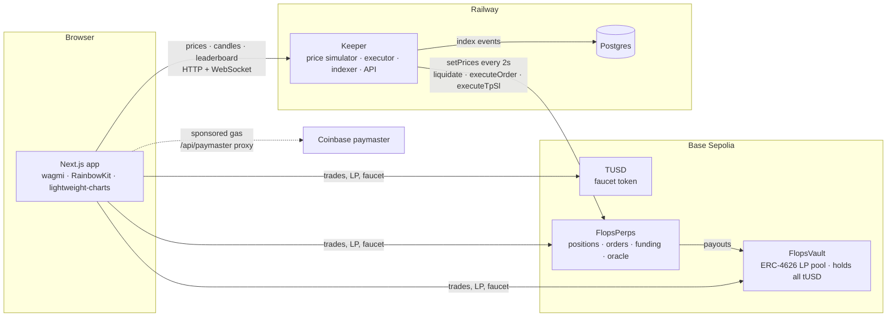

# FLOPS — GPU-hour perpetuals

**Long or short the hourly rental price of datacenter GPUs, fully on-chain.**

**Live demo: [flops-iota.vercel.app](https://flops-iota.vercel.app)** (Base Sepolia testnet)

FLOPS is a perpetual-futures exchange where the underlying asset is one hour of GPU compute:
H100, A100, RTX 4090 and L40S. Traders open isolated long or short positions with 1–25x
leverage against a shared liquidity pool. Every trade, liquidation, limit order and
take-profit settles in Solidity on Base Sepolia.

> ⚠️ **Testnet demo.** `tUSD` has no value, GPU prices and the news feed are **simulated**,
> and the contracts are **unaudited**. Don't deploy this to a network with real money.

---

## What's inside

| | |
|---|---|
| **Markets** | `H100-PERP`, `A100-PERP`, `RTX4090-PERP`, `L40S-PERP`, priced in tUSD per GPU-hour |
| **Leverage** | 1–25x, isolated margin, many independent positions per wallet |
| **Orders** | Market, limit, take-profit and stop-loss (executed by a keeper, verified on-chain) |
| **Counterparty** | `FLP` liquidity pool (ERC-4626) that anyone can deposit into |
| **Fees** | 0.1% open + 0.1% close, size-based price impact, 1 tUSD keeper fee for automated orders |
| **Funding** | Continuous, skew-based: the crowded side pays the other side, up to 0.05%/h |
| **Risk limits** | Each side of each market capped at 30% of the pool, one position ≤ 5%, liquidation below 1% maintenance margin |
| **Gas** | Sponsored for Base Account (smart wallet) users through a Coinbase paymaster |
| **Leaderboard** | Realized P&L and ROI (min. 100 tUSD margin), plus a live liquidation feed |

## Architecture



**`contracts/`** (Solidity + Foundry)
- `FlopsPerps.sol` is the trading engine: positions, limit orders, TP/SL, funding, liquidation and the keeper-fed price oracle. Positions are tracked as `units = size / entryPrice`, so per-market aggregates give exact pool-wide unrealized P&L in O(markets).
- `FlopsVault.sol` is the ERC-4626 LP pool. `totalAssets = balance − trader collateral − unrealized trader P&L`. Withdrawals are capped so open interest always stays within limits.
- `TUSD.sol` is the unlimited test faucet token.

**`keeper/`** (Node + TypeScript + viem)
- Simulates prices as a mean-reverting random walk (Ornstein–Uhlenbeck) per GPU. Net trader open interest pushes the price toward the crowded side, and fictional "demand events" spike or sink a market and decay over ~20 min.
- Posts all four prices in one transaction, only when needed, to keep gas costs low:

  | Situation | On-chain price updates |
  |---|---|
  | A trader opens or closes a position | right before it, on request from the website (`POST /api/refresh-prices`), so the fill matches the price on screen |
  | Someone has the site open in a visible tab | every 20s, keeping the price within the contract's 30s freshness limit while wallets confirm |
  | Positions or orders open | every 15s, or immediately when a TP/SL/limit order triggers or a price moves 0.5% |
  | Nothing open, nobody watching | every 5 min |

  The website's chart ticks every 2s from the simulator regardless. Each update costs about 72k gas. If the keeper wallet runs low on ETH, the site shows a "trading paused" banner with its address, and resumes on its own once funded.
- Triggers liquidations, limit orders and TP/SL. Every action is simulated before sending, and the contract re-checks every condition.
- Indexes contract events into Postgres (or embedded PGlite locally) and serves candles, trades, news, leaderboards and pool stats over HTTP and a WebSocket.

**`web/`** (Next.js 16 + Tailwind 4)
- Pages: Trade (chart, order panel, positions/orders/history, trade tape, news), Earn, Leaderboard, Portfolio.
- Smart wallets get one-click batched, gas-sponsored transactions (EIP-5792 + ERC-7677). Other wallets fall back to sequential transactions.

## Run it locally

Prerequisites: Node ≥ 22 and [Foundry](https://getfoundry.sh).

```bash
npm install
npm run dev:local
```

`dev:local` starts a local Anvil chain, deploys the contracts, exports ABIs, starts the keeper
(port 8787) and the website (http://localhost:3000). Click **Dev wallet** in the header to
trade with a pre-funded local test account. No browser extension is needed.

### Tests

```bash
npm run contracts:test   # 26 Foundry tests incl. a fuzzed conservation-of-funds invariant
npm test -w keeper       # price simulator + on-chain update schedule tests
```

## Deploy to Base Sepolia

1. **Wallets.** Run `bash scripts/new-wallets.sh`. It creates a deployer (owner) and a keeper wallet, saves their keys in `contracts/.env` (git-ignored) and prints only the addresses. Fund both with Base Sepolia ETH from a faucet. Deploying costs about 0.00004 ETH; the keeper pays for every price update, so give it the larger share.
2. **Contracts.**
   ```bash
   cd contracts
   forge script script/Deploy.s.sol --rpc-url base_sepolia --broadcast --slow
   cd .. && npm run abi
   ```
   Add `--verify` if you set `ETHERSCAN_API_KEY` in `contracts/.env`.
   This writes `contracts/deployments/84532.json` and regenerates the ABI modules. Commit both.
3. **Keeper → Railway.** Create a service from this repo with root directory `keeper`, and add a Postgres database. Environment:
   `CHAIN_ID=84532`, `RPC_URL=<Base Sepolia RPC>`, `KEEPER_PRIVATE_KEY`, `DATABASE_URL` (from the Postgres plugin), `CORS_ORIGINS=https://<your-vercel-domain>`.
4. **Paymaster (optional).** In the Coinbase Developer Platform, enable the Base Sepolia paymaster and allowlist the tUSD, FlopsVault and FlopsPerps addresses.
5. **Website → Vercel.** Import the repo with root directory `web`. Environment:
   `NEXT_PUBLIC_CHAIN_ID=84532`, `NEXT_PUBLIC_KEEPER_URL=https://<railway-domain>`, `PAYMASTER_URL=<CDP paymaster URL>` (server-only), and optionally `NEXT_PUBLIC_WC_PROJECT_ID`, `NEXT_PUBLIC_RPC_URL` and `ANTHROPIC_API_KEY` (server-only, turns on the "Ask FLOPS AI" assistant).

## Design notes and known limits

- **Oracle trust.** The keeper is a trusted price source. That's fine for a simulated market, but it's the first thing to replace in anything real.
- **Execution price.** Market orders fill at the last posted price plus size-based impact. With ~2s updates, someone watching the keeper's mempool could front-run a price post. That's harmless with valueless tokens.
- **Funding** accrues on entry notional and is zero-sum between longs and shorts. It doesn't accrue while one side is empty.
- **Pool insolvency** is prevented by the open-interest caps, not by profit caps. A huge, un-liquidated price gap could still leave the pool short.
- Admin can pause new trades (closing always works) and tune fees and risk limits. Contracts aren't upgradeable.

## License

MIT
